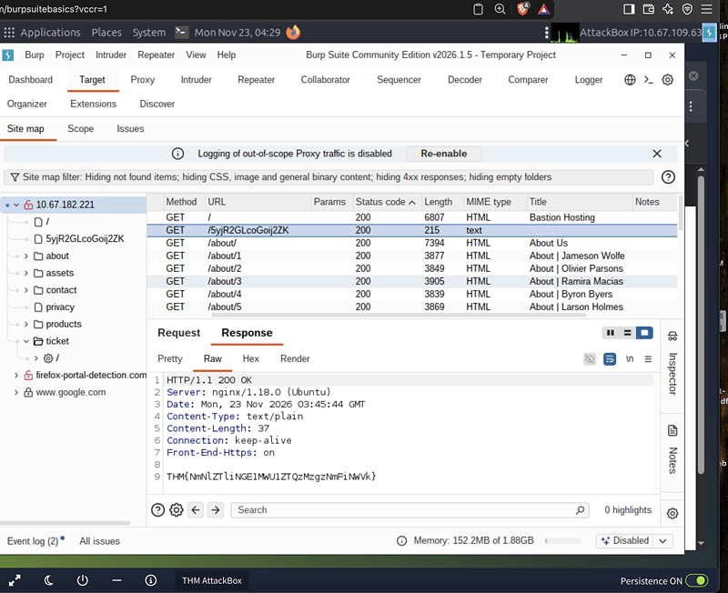
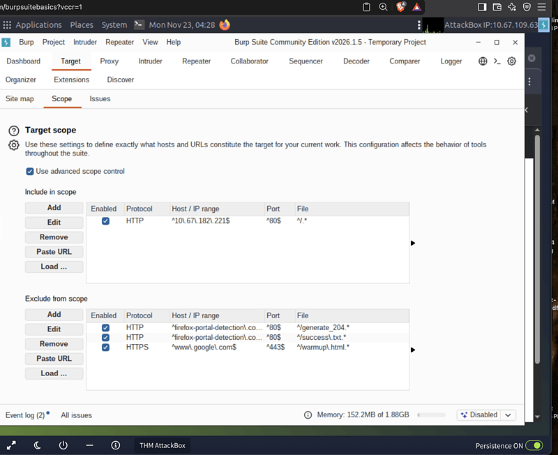
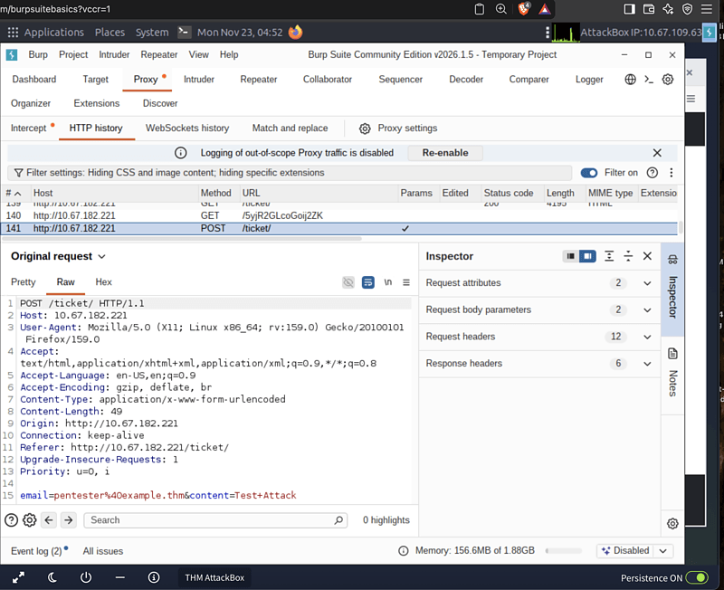
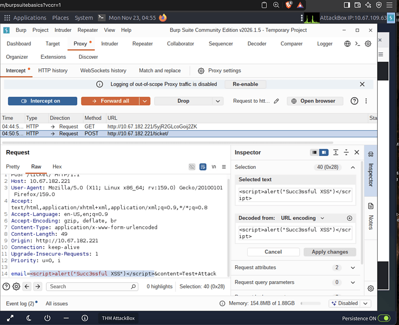
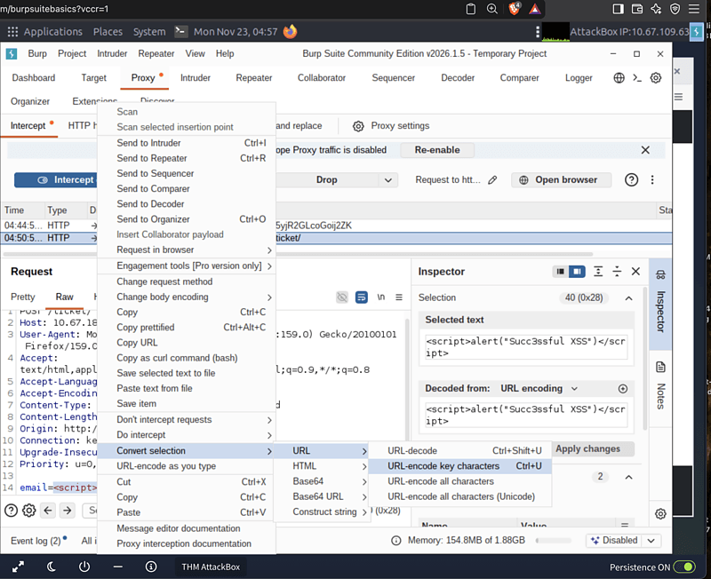
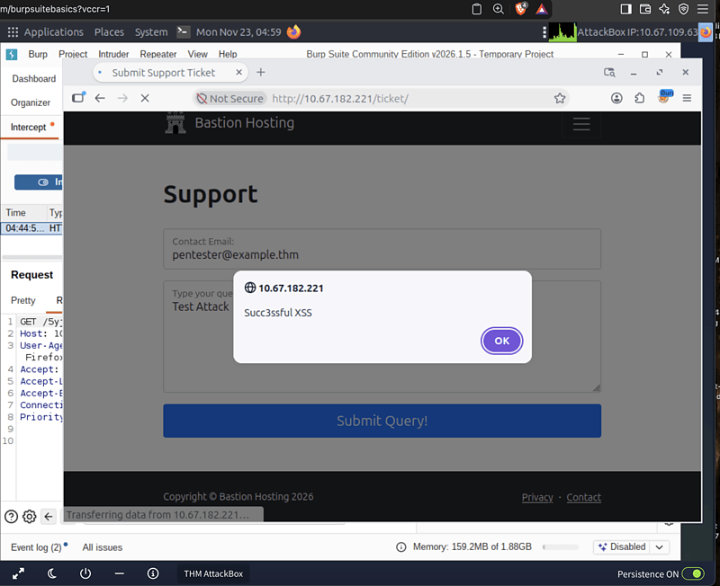

# Burpsuite Basics 

Note: tasks skipped in this Write Up did not contain any flags or end-of-task questions.  

### Task 10: Site Map and Issue Definition 

#### Challenge
Used Burp Suite to find unusual endpoint in sitemap for http://10.67.182.221/. 

Viewed "Response" tab for that endpoint to find the flag: 

```bash
HTTP/1.1 200 OK
Server: nginx/1.18.0 (Ubuntu)
Date: Mon, 23 Nov 2026 03:45:44 GMT
Content-Type: text/plain
Content-Length: 37
Connection: keep-alive
Front-End-Https: on

THM{NmNlZxxxxxxxxxxxxxxxxxxxxxxxxxxx}
```

[screenshot]
<br/><br />


### Task 12: Scoping and Targetting 

<br/><br />


### Task 14: Example Attack 

In a real-world web app pentest, we would test this for a variety of things, one of which would be Cross-Site Scripting (or XSS). If you have not yet encountered XSS, it can be thought of as injecting a client-side script (usually in Javascript) into a webpage in such a way that it executes. There are various kinds of XSS – the type that we are using here is referred to as "Reflected" XSS, as it only affects the person making the web request.

Walkthrough

Try typing: ```<script>alert("Succ3ssful XSS")</script>```, into the "Contact Email" field. You should find that there is a client-side filter in place which prevents you from adding any special characters that aren't allowed in email addresses:

Fortunately for us, client-side filters are absurdly easy to bypass. There are a variety of ways we could disable the script or just prevent it from loading in the first place.
<br /><br />


### Entered form field values, then altered values in HTTP History > Request via Burp Suite Proxy 

Set Burp Proxy to active, with "Intercept on". 

Entered form field values: 

* email address: ```"pentester@example.thm"``` 
* query: ```"Test Attack"``` 

Submit the form — the request should be intercepted by the proxy.

With the request captured in the proxy, we can now change the email field to be our very simple payload from above:
```javascript 
<script>alert("Succ3ssful XSS")</script>
``` 
<br />
<br />

After pasting in the payload, we need to select it, then URL encode it with the Ctrl + U shortcut to make it safe to send. <br />

<br />
<br />


    
